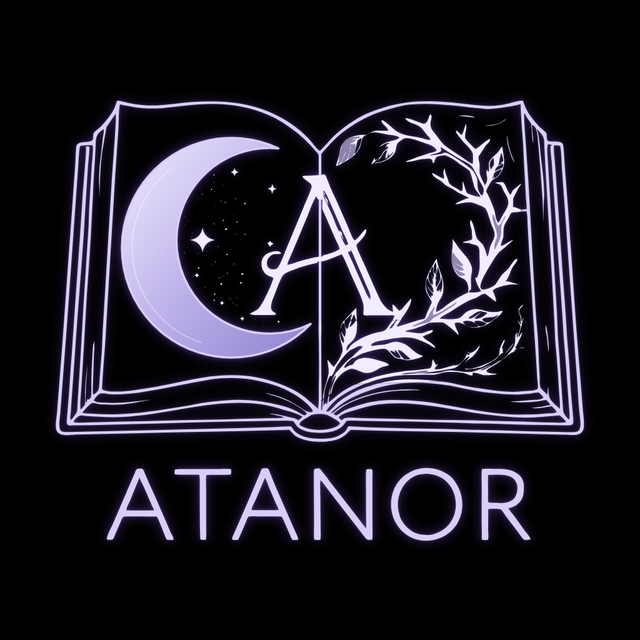

<div align="center">



# ATANOR

Leitor e organizador de e-books. Execução local, sem conexão externa.


</div>

## I. O Abismo

ATANOR importa arquivos EPUB, PDF e CBZ, converte PDF em EPUB com um conversor próprio (sem OCR) e organiza a biblioteca por status de leitura. Todo o processamento ocorre no aparelho. Não há revisão por IA, não há conta e não há saída online: o leitor roda com uma política de segurança que proíbe qualquer conexão de rede.

### Formatos

| Formato | Situação |
|---|---|
| EPUB | Suportado, em texto reflowável. EPUBs compostos só de imagens abrem no leitor de quadrinhos |
| PDF | Convertido para EPUB no aparelho. PDF escaneado vira EPUB de imagens, sem OCR, com aviso |
| CBZ | Suportado, no leitor de quadrinhos |
| CBR | Suportado quando o arquivo é um ZIP renomeado. CBR em RAR de verdade recebe aviso para converter para CBZ |
| MOBI, AZW3 | Ainda não suportados. O app avisa para converter para EPUB (por exemplo, com o Calibre) |
| DRM e PDF com senha | Não suportados. O app informa na importação |

Limite por arquivo: 100 MB.

### Biblioteca

- Aba **Sua Biblioteca** com todos os livros, e uma aba por status: Não Lido, Em Leitura, Pausado, Concluído e Desistido, cada uma com contador.
- Grade de capas com barra de progresso, status e favorito. Toque e segure, ou o menu de três pontos, abre a tela de status.
- Tela de status: troca de status, edição de título, autor, ano, editora, gênero e tags, troca de capa, favorito, exportar, compartilhar e remover. Remover apaga o arquivo só da memória do app; cópias exportadas não são alteradas.
- Busca geral, **ordenação** (adição, título, autor, status, última leitura e progresso) e **filtro** (autor, ano, editora, gênero, tag e favoritos), ambos em menus flutuantes.
- Importação de vários arquivos de uma vez, com detecção de duplicatas.
- Idioma da interface segue o aparelho (português ou inglês). Tema sempre escuro, conforme o padrão CHAOS.

### Leitor de texto

- Paginação com animação de página, ou rolagem contínua. A escolha fica em Aa, aba Texto:
  - **Virar** (padrão): a página gira em torno da lombada e revela a seguinte por baixo, com sombra na borda, como uma página de livro. Ao arrastar, a página acompanha o dedo; soltando antes de 30% ou devagar, ela volta. Em livros muito grandes (mais de 1.500 páginas ou 100 mil elementos) cai para uma versão simples do efeito.
  - **Deslizar**: a página desliza acompanhando o dedo.
  - **Nenhuma**.
- Página dupla em paisagem.
- Sumário, busca no livro com destaque, marcadores e barra de progresso arrastável.
- Ajustes: fonte (serifa, sans ou mono), tamanho, espaçamento, margens, alinhamento, brilho e tema (escuro, noturno ou claro).
- O progresso é salvo automaticamente, e o app oferece marcar como Concluído ao chegar ao fim.

### Leitor de quadrinhos

- Virar página por toque nas bordas (imediato, sem esperar o duplo toque) ou por deslize, com a mesma animação escolhida nos ajustes. O duplo toque para zoom vale no centro da tela ou quando já há zoom.
- Duplo toque para zoom, zoom por pinça e arrastar a imagem ampliada.
- Direção de leitura direita→esquerda e página dupla em paisagem.

### Gestos do leitor

| Gesto | Efeito |
|---|---|
| Deslizar na horizontal | Vira a página |
| Toque nas bordas | Vira a página |
| Toque duplo no centro | Mostra ou esconde os controles (nos quadrinhos: zoom) |
| Pinça para dentro | Mostra os controles |
| Pinça para fora | Esconde os controles |
| Toque no rodapé de status | Alterna entre "Página x de y", "páginas restantes no capítulo" e oculto |

## II. Arquitetura do Núcleo

```text
App.js                    interface: biblioteca, menus, tela de status e leitor
index.js                  ponto de entrada
src/engine.js             motor em WebView: importação, conversor PDF→EPUB, leitor de texto e de quadrinhos
src/engine.css            tema do leitor (Void Black, Moonlight; papel claro opcional)
src/theme.js              tokens CHAOS v1.2
scripts/build-engine.js   embute JSZip, pdf.js e o motor em src/engineHtml.js (arquivo gerado, offline)
assets/                   logo, ícone, ícone adaptativo, splash
tests/                    testes do motor em Chromium headless
eas.json                  perfis de build (APK de teste e AAB de produção)
```

A interface é React Native. Tudo o que lida com o conteúdo do livro roda em uma WebView isolada: o app envia o arquivo em blocos de 1,5 MB, e o motor decodifica direto para bytes. O motor só se comunica com o app por mensagens.

### Privacidade

- O conteúdo do livro é sanitizado: sem scripts, manipuladores de evento, iframes, URLs remotas ou estilos com `url()`.
- A página do motor declara uma política de segurança (`default-src 'none'`), então nada do livro abre conexão.
- Os arquivos, capas e metadados ficam no armazenamento interno do app.

## III. Rituais de Configuração

```bash
npm install          # o postinstall gera src/engineHtml.js
npx expo start --go  # abre no Expo Go; escaneie o QR code com o celular na mesma rede
```

Observações:

- **Não rode `npm audit fix --force`.** Os avisos de vulnerabilidade vêm das ferramentas de desenvolvimento do Expo (CLI, Metro), não do app instalado, e esse comando rebaixa o `expo` para o SDK 50 e remove pacotes. Se isso acontecer: apague `node_modules` e `package-lock.json`, restaure o `package.json` original e rode `npm install --ignore-scripts`, `npx expo install --fix` e `npm run build:engine`.
- O Expo Go das lojas só abre o SDK atual. Se aparecer "Project is incompatible", atualize o projeto para o SDK que o Expo Go pedir: `npx expo install expo@^58.0.0 --fix`.
- Depois de alterar `src/engine.js`, rode `npm run build:engine` para regenerar a página do motor.
- Não use `a` no terminal sem o Android SDK instalado; escaneie o QR code.

### Gerar o APK

```bash
npm install -g eas-cli
eas login
eas build -p android --profile preview     # APK para instalar direto no aparelho
eas build -p android --profile production  # AAB para a Google Play
```

O EAS compila na nuvem; não é preciso o Android SDK na sua máquina. Aceite a geração da chave de assinatura no primeiro build. Se o EAS reclamar de repositório Git, rode `git init`, `git add .` e `git commit -m "init"`.

### Testes

O motor (importação, conversão de PDF, leitor de texto e de quadrinhos, busca e gestos) roda em Chromium headless, sem celular:

```bash
pip install playwright pillow && playwright install chromium
npm run test:engine                          # 68 testes
python3 tests/perf_test.py /tmp/engine.html  # carga: EPUB de 200 capítulos e CBZ de 200 páginas
```

Os testes geram seus próprios arquivos (`tests/make_fixtures.py`): EPUB, EPUB com DRM, CBZ, CBR, PDF de texto e PDF escaneado. A interface React Native não tem testes automatizados; valide no aparelho.

## IV. Inscrições e Registros

- `1.3.0`: virada de página realista em duas camadas (a página gira sobre a lombada e revela a seguinte, com sombra e acompanhando o dedo), também nos quadrinhos; toques nas bordas dos quadrinhos viram na hora; gesto cancelado pelo sistema (`pointercancel`) não vira mais a página no sentido errado; arrastar sobre imagens do livro não vira arrastar-e-soltar; 68 testes do motor.
- `1.2.2`: armazenamento tolerante a falhas (o app não quebra se o módulo nativo do AsyncStorage faltar), AsyncStorage fixado em 2.2.0 e mensagem clara no `build:engine` quando faltar dependência.
- `1.2.1`: animação de página reescrita. O efeito de virar em 3D passa a ser o padrão (com Deslizar e Nenhuma como opções) e usa a Web Animations API no próprio visor; corrigido o caso em que a página ficava girada e invisível depois de virar. 54 testes do motor, incluindo verificação visual do estado após cada virada.
- `1.2.0`: revisão de erros e desempenho. Rede bloqueada no leitor (política de segurança e sanitização), cartões da biblioteca memoizados, progresso e gravação com agrupamento, envio e resposta em blocos, abertura do leitor com uma única paginação, pré-carga de páginas nos quadrinhos, títulos e sumário no PDF convertido, caminhos reancorados no iOS, exportação com o título do livro, 49 testes do motor.
- `1.1.0`: leitor com deslize animado, página dupla em paisagem, duplo toque para zoom, busca no livro, marcadores, barra de progresso arrastável, menus flutuantes de ordenação e filtro, controles por toque duplo ou pinça, rodapé de status tocável, tema claro opcional no leitor, CBR em ZIP.
- `1.0.0`: biblioteca com abas por status, importação em lote, conversão local de PDF, leitor de texto e de imagens, progresso persistido.
- Pendente: MOBI e AZW3, CBR em RAR, importação de pasta inteira, coleções, backup da biblioteca.

## V. Selos Finais

Licença: a definir.

Vitor Araújo · [GitHub](https://github.com/jvitoraraujo) · [LinkedIn](https://www.linkedin.com/in/vitor-ara%C3%BAjo-55a98942b) · vitoraraujo02@gmail.com

*A massa informe onde os elementos repousam em eterno conflito.*

C H A O S
